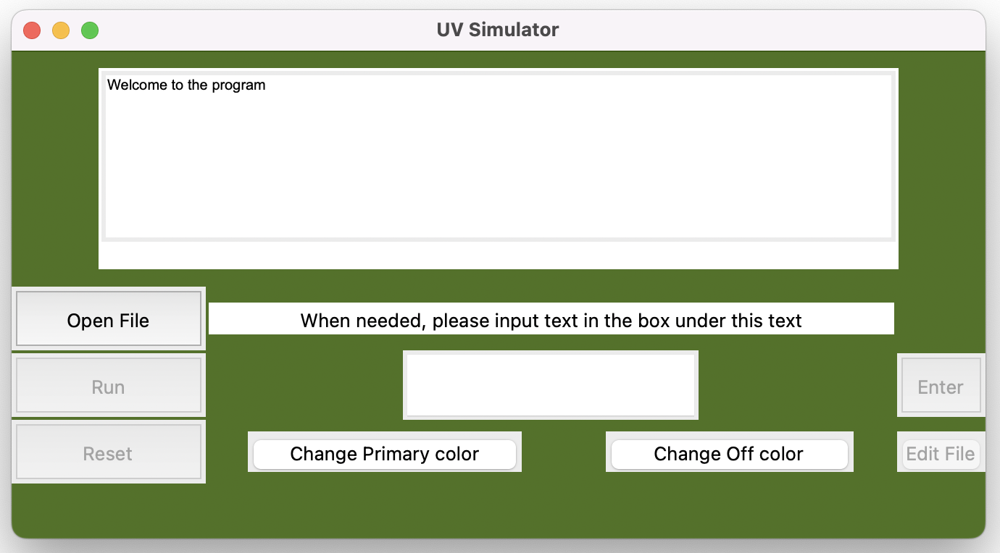
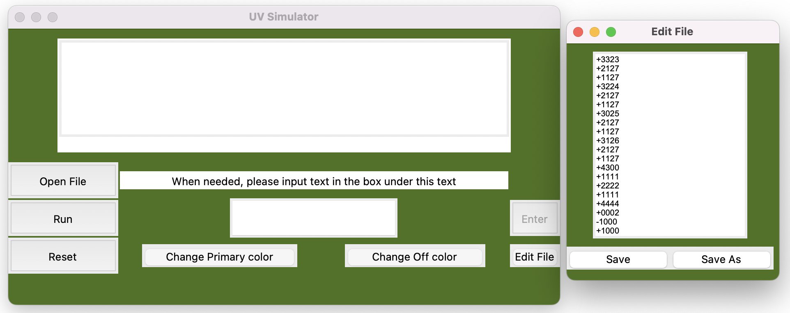

# CS-2450 Project - UVSim

UVSim is a simple CPU simulator written in Python. The program reads UVSim instructions from a text file, loads them into memory, and executes the instructions one at a time.

The simulator supports user input and output, loading and storing values, arithmetic operations, branching, and halting. The project also includes a Tkinter graphical user interface that allows the user to select a UVSim program file, run the program, enter values when requested, view program output, and view errors.

## Requirements

The following are required to run UVSim:

- Python 3
- Tkinter
- The included `functions.py` file
- pytest, only if running the unit tests

Tkinter is part of the Python standard library and is included with most standard Python installations. No additional third-party GUI framework is required.

The project does not require any additional third-party modules to run the GUI.

`pytest` is only required if the user wants to run the project's automated tests.

If pytest is not installed, it can be installed with:

`pip install pytest`

## Project Files

The main files used by the application are:

- `main.py` - Contains the CPU and its CommunicationUnit, ArithmeticUnit, and ControlUnit classes.
- `gui.py` - Contains the Tkinter graphical user interface.
- `functions.py` - Contains input-validation functions used by the CPU and GUI.
- `program_test.py` - Contains automated tests for the CPU and its operations.
- `Testing_files` - Contains UVSim program files used for testing.

These files should remain together in the project structure so the imports in the program can locate the required modules.

## Running the Program

Open a terminal or command prompt in the project's main directory.

Run:

`python main.py`

Depending on the Python installation, the command may instead be:

`python3 main.py`

Running `main.py` opens the UVSim graphical user interface.

The user should not manually run `gui.py`.

## Using the GUI

The UVSim GUI contains two main screens.

The first screen is the main screen that contains the file selector, the Run and Reset buttons, the user input box, the output box, and the Enter and Edit File buttons. Here is an image of what the first screen looks like on Mac:

The color scheme is initially set to match that of UVU's colors.

### Open File

Click the `Open File` button to open the file-selection window.

Select a `.txt` file containing a UVSim program.

The program attempts to validate the file before allowing it to run.

If the file is valid, the CPU is created and the Run button becomes clickable.

If the selected file contains invalid UVSim instructions, an error message is displayed underneath the output textbox instead of running the file.

If the file-selection window is closed without selecting a file, the GUI displays an error asking the user to select a file.

### Run

The `Run` button begins executing the selected UVSim program.

The CPU reads the program instructions one at a time and performs the requested operation.

Depending on the program, execution may:

- Produce output
- Request input from the user
- Perform arithmetic
- Load or store values
- Branch to another instruction
- Halt the program

After being clicked, the Run button is disabled so the same program does not start multiple times at once.

If you wish to run the same program again, either click the Open File button and select the same file, or click the Reset Button and then click the Run button again.

### Reset

The `Reset` button clears the output box's contents and preps the program to run again the same file that the user previously selected.

### Output Box

The large box at the top of the execution screen displays output produced by the UVSim program.

WRITE operations send their values to this output box.

Other user-facing CPU messages, such as the `Halted` message, can also appear in the output box.

Each new output is added on a new line rather than replacing the previous output. The output box automatically moves to the most recent output as additional values are displayed.

The output box is read-only, so the user cannot type into it.

### Input Field

Some UVSim programs contain a READ instruction and require the user to enter a value.

When the CPU reaches a READ instruction, the input field and Enter button become enabled.

The GUI also changes the text above the input field to tell the user that a value is required.

The user may enter a value using either of these formats:

`+####`

`-####`

or a four-digit positive value without the `+` sign:

`####`

Examples of valid input include:

`+1234`

`-1234`

`1234`

If a four-digit positive value such as:

`1234`

is entered, UVSim automatically stores it as:

`+1234`

Invalid input is rejected and the user remains on the input screen so another value can be entered.

### Enter

After typing a value into the input field, click the `Enter` button.

The GUI validates the value and passes it to the CPU.

If the input is valid, the CPU stores the value in the memory location specified by the READ instruction and continues executing the program.

If the input is invalid, execution does not continue until the user enters a valid value.

### Change Primary color

The `Change Primary Color` button opens a color picker for the user to select the background color of the GUI. This effects the main screen as well as the `Edit File` Screen.

### Change Off color

The `Change Off color` button opens a color picker for the user to select the textbox colors and button colors of the GUI. This effects the main screen as well as the `Edit File` Screen.

### Edit File

The Edit File button becomes selectable once the user opens a .txt file whether or not the file is valid or contains malformed code. Clicking the Edit File button will open the second main screen that the user can use, which is the Edit File screen:

The Edit File screen is populated with the commands of the user-selected .txt file. The text box is editable, allowing the user to make adjustments to the code through the program without needing to open up the file seperately. This is useful if the file is malformed or if the user wants to change the functionality of their code.

Once the user finishes editing their code though the textbox, the user can either select to `Save`, or `Save as`.

`Save` modifies the currently selected file to match the modifications that the user made within the file editor screen. 

`Save as` allows the user to make a copy of the file to a desired location in their filesystem without modifying the original file.

Additional validation will be performed when the user clicks `Save` or `Save as`. If the edits contain invalid content, an error will be shown to the first GUI screen, and the contents will not be savable until the errors are fixed by the user. 

When the user selects `Save` or `Save as` and all lines of code are valid, the program will be loaded with the new file modifications, ready to run.

## Program File Format

UVSim programs are stored in `.txt` files.

Each program instruction must use the following format:

`+####`

or:

`-####`

For example:

`+2010`

In this instruction:

- `20` is the operation code.
- `10` is the memory address used by the operation.

The CPU contains 100 memory locations numbered `00` through `99`. Program instructions are loaded into memory starting at location `00`. 

The user must select a file that is 100 lines of commands long or less. If the user selects a .txt file with more than 100 lines of commands, an error is displayed to the screen.

Unused memory locations are initialized to:

`+0000`

Program files themselves must contain properly formatted five-character values. The four-digit shorthand accepted during READ input is intended for user input and should not be used for instructions stored in a program file.

## Supported Commands

UVSim supports the following commands:

- `10` - READ: Reads a value from the user and stores it in the specified memory location.
- `11` - WRITE: Displays the value stored in the specified memory location.
- `20` - LOAD: Loads a value from memory into the accumulator.
- `21` - STORE: Stores the current accumulator value in a memory location.
- `30` - ADD: Adds a value from memory to the accumulator.
- `31` - SUBTRACT: Subtracts a value in memory from the accumulator.
- `32` - DIVIDE: Divides the accumulator by a value stored in memory.
- `33` - MULTIPLY: Multiplies the accumulator by a value stored in memory.
- `40` - BRANCH: Moves execution to a specified memory location.
- `41` - BRANCHNEG: Moves execution to a specified memory location if the accumulator is negative.
- `42` - BRANCHZERO: Moves execution to a specified memory location if the accumulator is zero.
- `43` - HALT: Stops program execution.

## READ Input

The READ command allows a UVSim program to request a value from the user.

The accepted input formats are:

`+####`

`-####`

or:

`####`

The four-digit version is treated as a positive value.

For example:

`1234`

is stored as:

`+1234`

The value is stored in the memory address specified by the READ instruction.

If the value does not match one of the accepted formats, the program rejects the input and waits for another value.

## WRITE Output

The WRITE command retrieves the value stored at the specified memory address and displays it.

When the program is running through the GUI, WRITE output appears in the GUI output box.

For example, if a memory location contains:

`+1234`

a WRITE instruction for that address displays:

`+1234`

The CPU uses a shared output method so program output is sent to the GUI when the GUI is active. If the CPU is being used without a GUI, output can instead be printed to the terminal.

## Math and Overflow

The CPU uses signed four-digit values.

ADD, SUBTRACT, MULTIPLY, and DIVIDE use the value currently stored in the accumulator together with a value stored in memory.

If an arithmetic operation produces a result containing more than four digits, the leading digits are truncated.

For example:

`12345`

becomes:

`+2345`

Negative results follow the same four-digit rule while preserving the negative sign.

For example:

`-12345`

becomes:

`-2345`

DIVIDE also checks for division by zero.

Attempting to divide by zero raises an error.

## Program Structure

The simulator separates responsibilities between the CPU, its operation units, the GUI, and shared validation functions.

### CPU

The `CPU` class manages:

- Memory
- The accumulator
- Program loading
- Program validation
- Instruction execution
- Communication between CPU units
- Sending user-facing output to the GUI or terminal

The CPU determines the current operation code and sends the operation to the appropriate unit.

### FileHandler

The `FileHandler` handles file validation. If the contents of the selected .txt file do not match the structure outlined in **Program File Format**, the GUI will display an error explaining the issue with the selected file.

### CommunicationUnit

The `CommunicationUnit` handles:

- READ
- WRITE

READ validates and stores user input in CPU memory.

WRITE retrieves a value from CPU memory and sends it through the CPU's output method.

### ArithmeticUnit

The `ArithmeticUnit` handles:

- ADD
- SUBTRACT
- DIVIDE
- MULTIPLY

These operations use CPU memory and the accumulator.

Arithmetic results are stored back in the accumulator using the signed four-digit UVSim format.

### ControlUnit

The `ControlUnit` handles:

- LOAD
- STORE
- BRANCH
- BRANCHNEG
- BRANCHZERO
- HALT

LOAD and STORE move values between memory and the accumulator.

The branch operations control which memory location the CPU executes next.

HALT stops program execution.

### Gui

The `Gui` class provides the graphical interface.

It handles:

- File selection
- Starting and continuing CPU execution
- User input
- Input validation
- Displaying output
- Displaying errors
- Enabling and disabling controls when input is required
- Editing capabilities
- Saving file edits

### Utility Functions

`functions.py` contains shared validation functions used by the CPU and GUI.

`checkValidInput5chars(input)` checks for a sign followed by four digits, such as:

`+1234`

or:

`-1234`

`checkValidInput4chars(input)` checks for exactly four digits without a sign, such as:

`1234`

Four-digit input is interpreted as a positive value when it is entered by the user.

## Error Handling

UVSim validates program files before executing them.

Errors that may be detected include:

- No file was selected.
- The selected file does not exist.
- The filepath is invalid.
- An instruction contains the wrong number of characters.
- An instruction does not begin with the required sign.
- An instruction contains invalid characters.
- An unsupported operation code is used.
- A program attempts to access an invalid memory location.
- A DIVIDE operation attempts to divide by zero.
- User input does not match one of the accepted READ formats.
- The file contains more than 100 lines of commands (whitespace included)

Malformed UVSim files produce an error instead of being executed.

The GUI displays file-selection and file-validation errors to the user.

## Testing

The project uses pytest for automated unit testing.

To install pytest if necessary:

`pip install pytest`

To run the tests from the main project directory:

`pytest`

The automated tests cover:

- File validation
- CPU initialization
- Memory initialization
- READ
- WRITE
- LOAD
- STORE
- ADD
- SUBTRACT
- MULTIPLY
- DIVIDE
- Arithmetic overflow
- Branching
- Halting

In addition to the automated tests, the supplied UVSim test files can be opened through the GUI to verify full program execution, user input, output, arithmetic, branching, overflow handling, and malformed-file handling.

## Basic User Workflow

A typical use of the application is:

1. Run `python main.py`.
2. Click `Open File`.
3. Select a valid UVSim `.txt` program.
4. Edit the file using `Edit File` if an error arises and save the edits.
5. Click `Run`.
6. If the program requests input, type the requested value into the input field.
7. Click `Enter`.
8. Continue entering values if additional READ instructions occur.
9. View WRITE results in the output box.
10. The program continues until a HALT instruction is reached.
11. Click `Open File` to choose a new file to run or `Reset` then `Run` again to rerun the same file.

## Group Members

Trevor, Nate, Enoch, and Kiara
